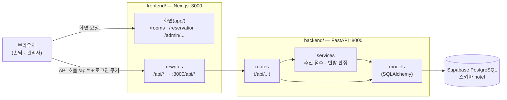
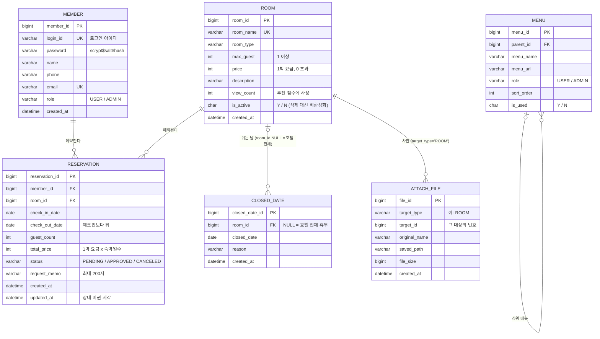
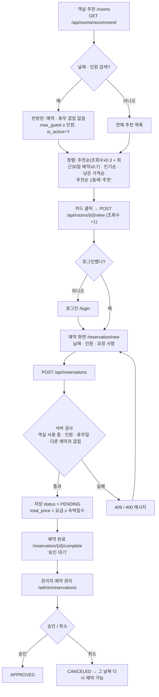
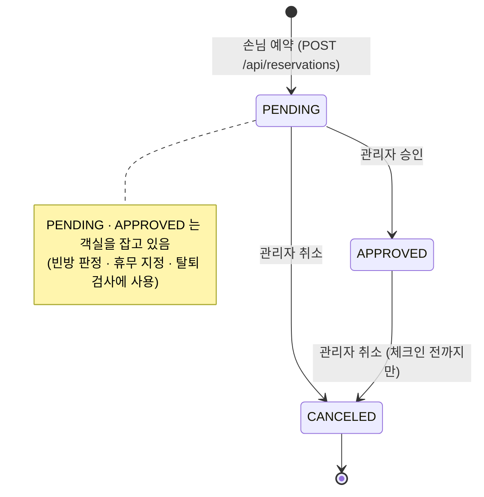
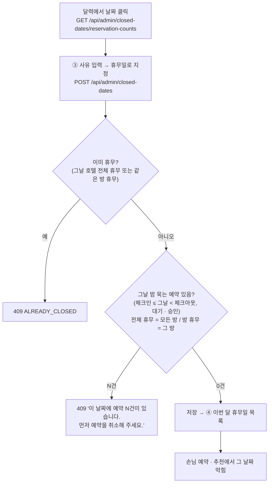
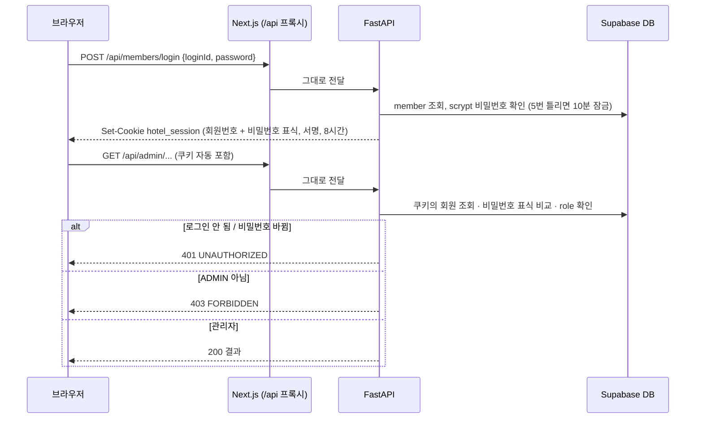

# 태양의 호텔 — 시스템 구조 한눈에 보기

GitHub에서 그림(Mermaid)으로 보입니다. 기준: **dev 브랜치, 11-24**(Step 1 + Step 2 진행분). DB는 Supabase(PostgreSQL) 팀 프로젝트 하나: 각자 개발은 스키마 hotel_<이름>, 시연은 공용 스키마 hotel. DB 시간대는 `Asia/Seoul`(11-24부터).

제품 요구사항 · 기술 명세 · 작업 단위는 [`../DevelopDoc/`](../DevelopDoc/)에 있습니다.

## 1. 전체 구조

- 브라우저는 `localhost:3000` 한 주소만 봅니다. 그래서 로그인 쿠키(HttpOnly, SameSite=Lax)가 그대로 동작하고 CORS 설정이 필요 없습니다.
- DDL: `docs/hotel_reservation_ddl.sql`. 개발 DB 만들기: `backend`에서 `uv run python -m app.db.init_db`(내 스키마 `hotel_<이름>`에만. 공용 `hotel`은 `--reset-shared`가 있어야 지워짐).

## 2. DB 구조 (ERD)

## 3. 손님 예약 흐름 (ROOM-001 → RSV-001 → RSV-002 → ADM-003)

## 4. 예약 상태

## 5. 휴무일 지정 (ADM-002)

- 지난 날짜도 지정 · 해제할 수 있습니다(잘못 넣은 기록을 고치기 위해, 팀 결정 #32).
- 기간 지정(`POST .../range`, 최대 31일)은 막힌 날짜를 모두 모아 `409`와 `detail.blockedDates`로 알려 주고, 하나라도 막히면 저장하지 않습니다.
- 기간 해제(`DELETE .../range?startDate=&endDate=&roomId=`)는 같은 범위(호텔 전체 또는 그 방)에 직접 지정된 휴무만 지웁니다.
- 전체 객실 달력의 "남은 N실"은 `GET .../available-rooms?month=`(사용 중 객실 − 휴무 객실 − 숙박 중 객실)를 씁니다.

## 6. 로그인과 권한 확인

## 7. 화면 · API 현황 (11-24, dev)

| 파트 | 화면 (Next.js) | API (`/api` 생략) | 상태 |
|---|---|---|---|
| 1 회원 · 객실 추천 | `/login` `/signup` `/mypage` `/password-reset` `/rooms` | `members/signup · login · logout · me`, `PUT members/me`, `PUT members/me/password`, `POST members/me/withdraw`, `POST members/password-reset`, `GET rooms/recommend`, `POST rooms/{id}/view` | 구현 (마이페이지 정보 수정 · 비밀번호 변경 · 탈퇴, 비밀번호 찾기 화면 포함) |
| 2 객실 관리 (ADM-001) | `/admin/rooms` | `GET POST admin/rooms`, `GET admin/rooms/summary`, `PUT admin/rooms/{id}`, `PATCH admin/rooms/{id}/status`, `POST GET files`, `DELETE files/{id}` | 구현 (사진 업로드 · 요약 카드 · 미래 예약 객실 수정 제한 · 시연용 40실 `demo_seed.sql`) |
| 3 예약 일자 관리 (ADM-002) | `/admin/closed-dates` | `GET admin/closed-dates`, `GET admin/closed-dates/reservation-counts`, `GET admin/closed-dates/available-rooms`, `POST` · `POST range`, `DELETE admin/closed-dates/{id}` · `DELETE range` | 구현 (객실 선택 · 달력 · 기간 지정/해제 · Shift+클릭 · 이번 달 목록) |
| 4 객실 예약 · 완료 (RSV-001/002) | `/reservation/new` `/reservation/{id}/complete` `/reservation/list` | `POST reservations`, `GET reservations/{id}`, `GET reservations/me`, `GET rooms/{id}` | 구현. **남음:** 지난 날짜 차단, `rooms/{id}/available-dates`(501, 이슈 #27) |
| 5 공통 · 예약 관리 (ADM-003) | `/admin/reservations`, 상단 메뉴 | `GET admin/reservations`, `PATCH admin/reservations/{id}/approve · cancel`, `GET menus` | 구현 |

전체 API 목록과 입력 · 출력 모양은 서버를 켜고 http://localhost:8000/docs 에서 봅니다.
