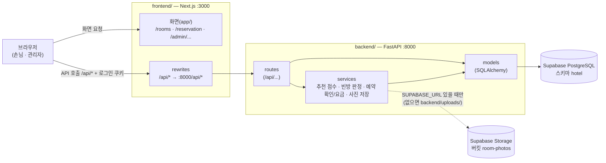
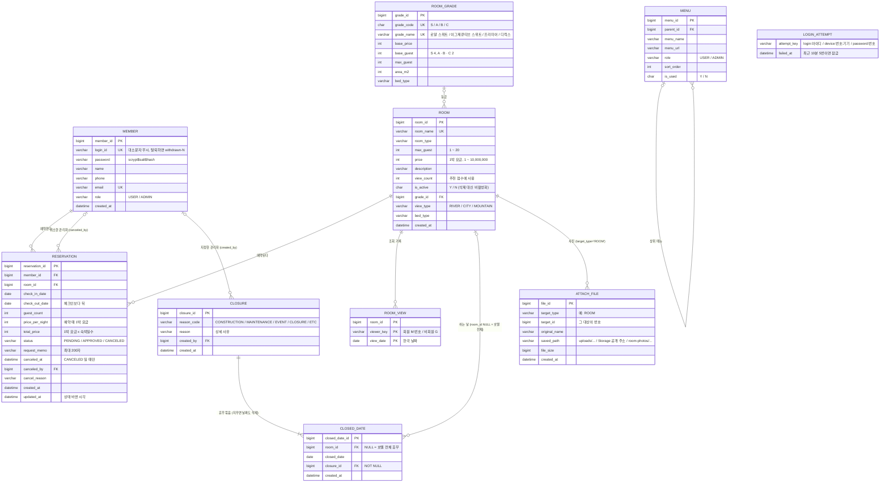
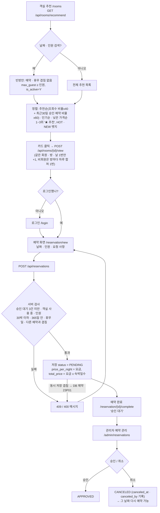
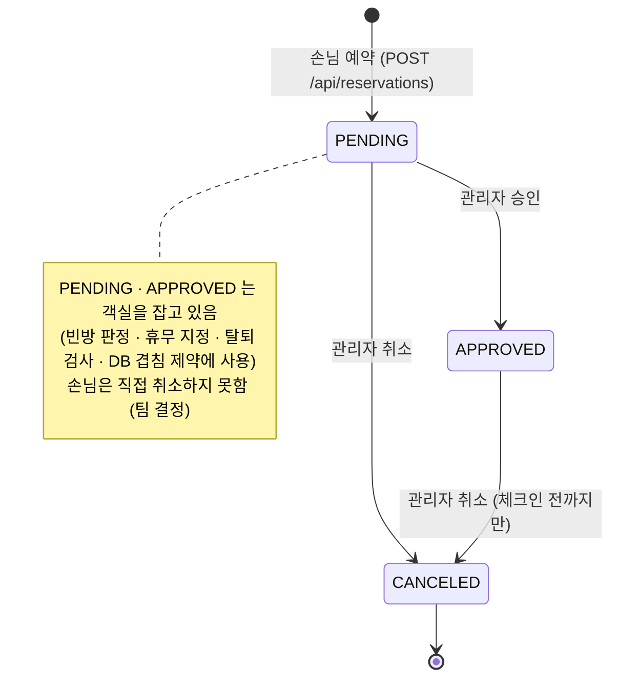
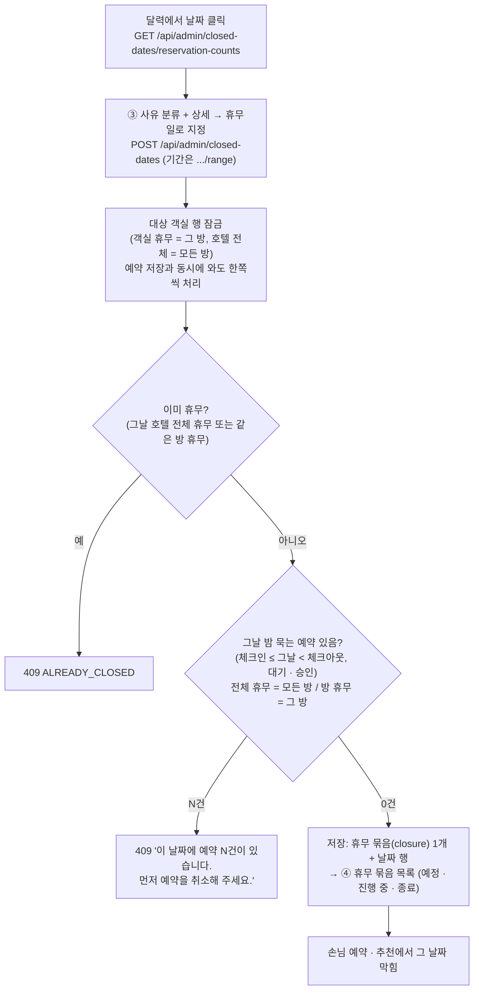
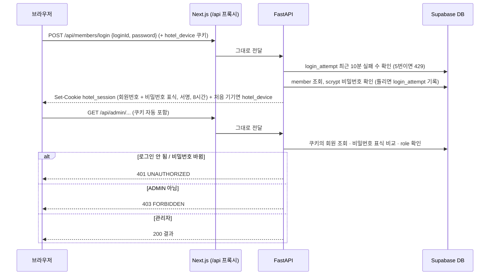

# 태양의 호텔 — 시스템 구조 한눈에 보기

GitHub에서 그림(Mermaid)으로 보입니다. 기준: **dev `251bf9c`, 2026-11-25 (Step 3 반영)**(Step 1 + Step 2 + Step 3-A, PR #83까지). 이전 판: [archive/2026-11-25_step2/docs/ARCHITECTURE.md](archive/2026-11-25_step2/docs/ARCHITECTURE.md). DB는 Supabase(PostgreSQL) 팀 프로젝트 하나: 각자 개발은 스키마 hotel_<이름>, 테스트는 hotel_<이름>_test, 시연은 공용 스키마 hotel. DB 시간대는 `Asia/Seoul`(11-24부터).

제품 요구사항 · 기술 명세 · 작업 단위는 [`../DevelopDoc/`](../DevelopDoc/)에 있습니다.

## 1. 전체 구조

- 브라우저는 `localhost:3000` 한 주소만 봅니다. 그래서 로그인 쿠키(HttpOnly, SameSite=Lax)가 그대로 동작하고 CORS 설정이 필요 없습니다.
- DDL: `docs/hotel_reservation_ddl.sql`. 개발 DB 만들기: `backend`에서 `uv run python -m app.db.init_db`(내 스키마 `hotel_<이름>`에만. 공용 `hotel`은 `--reset-shared`가 있어야 지워짐).
- 이중 예약 제약에 쓰는 `btree_gist` 확장은 팀 Supabase에 `extensions` 스키마로 켜 둠(DDL에는 없음).
- 주소에 DB 숫자 범위를 넘는 번호가 오면 500 대신 404(`main.py`, 모든 API 공통).

## 2. DB 구조 (ERD, 테이블 10개)

- `reservation` 제약: `ck_reservation_canceled`(`CANCELED` ↔ `canceled_at` 있음), `ex_reservation_no_overlap`(살아 있는 예약끼리 같은 방 `[체크인, 체크아웃)` 겹침 금지, `EXCLUDE USING gist`). 인덱스는 `idx_reservation_member`, `idx_reservation_live`.
- `closed_date`: `UNIQUE NULLS NOT DISTINCT (room_id, closed_date)`. 사유 칸은 없어지고 `closure`에 한 번만.

## 3. 손님 예약 흐름 (ROOM-001 → RSV-001 → RSV-002 → ADM-003)

## 4. 예약 상태

## 5. 휴무일 지정 (ADM-002)

- 지난 날짜도 지정 · 해제할 수 있습니다(잘못 넣은 기록을 고치기 위해, 팀 결정 #32).
- 사유 분류는 공사 `CONSTRUCTION` · 점검 `MAINTENANCE` · 행사 `EVENT` · 휴관 `CLOSURE` · 기타 `ETC`. 분류가 없으면 기타로 보고 상세가 필수입니다.
- 기간 지정(`POST .../range`, 최대 31일)은 막힌 날짜를 모두 모아 `409`와 `detail.blockedDates`로 알려 주고, 하나라도 막히면 저장하지 않습니다.
- 기간 해제(`DELETE .../range?startDate=&endDate=&roomId=`, 최대 31일)는 같은 범위(호텔 전체 또는 그 방)에 직접 지정된 휴무만 지웁니다. 날짜가 하나도 안 남은 묶음은 함께 지워집니다.
- 묶음 목록 `GET /api/admin/closures?month=&roomId=`, 묶음 해제 `DELETE /api/admin/closures/{id}`(날짜 행도 함께 삭제). 상태는 오늘(KST) 기준 시작 전 = 예정, 끝난 뒤 = 종료, 그 사이 = 진행 중.
- 전체 객실 달력의 "남은 N실"은 `GET .../available-rooms?month=`(사용 중 객실 − 휴무 객실 − 숙박 중 객실)를 씁니다. `month` 연도는 2000~2100.

## 6. 로그인과 권한 확인

- 실패 횟수는 처음 보는 기기면 아이디 하나로, 로그인에 성공한 적 있는 기기(`hotel_device`)면 그 기기만 따로 셉니다. 남이 일부러 잠가도 주인은 쓰던 기기로 들어올 수 있습니다.
- 비밀번호 찾기(`POST /api/members/password-reset`)는 시연 전까지 꺼 두어 항상 403입니다.

## 7. 화면 · API 현황 (11-25, dev `251bf9c`)

| 파트 | 화면 (Next.js) | API (`/api` 생략) | 상태 |
|---|---|---|---|
| 1 회원 · 객실 추천 | `/login` `/signup` `/mypage` `/password-reset` `/rooms` `/rooms/{id}` | `members/signup · login · logout · me`, `PUT members/me`, `PUT members/me/password`, `POST members/me/withdraw`, `POST members/password-reset`(403), `GET members/check-id`, `GET rooms/recommend`, `GET rooms/{id}`, `POST rooms/{id}/view` | 구현 (조회수 하루 1번 · 로그인 잠금 DB 저장 · 비밀번호 찾기 꺼 둠 · 회원 화면 디자인) |
| 2 객실 관리 (ADM-001) | `/admin/rooms` | `GET POST admin/rooms`, `GET admin/rooms/summary`, `PUT admin/rooms/{id}`, `PATCH admin/rooms/{id}/status`, `GET room-grades`, `POST GET files`, `DELETE files/{id}` | 구현 (등급 · 전망 · 침대, 사진 Storage 저장, 입력 상한, 예약 있는 방 비활성화 409) |
| 3 예약 일자 관리 (ADM-002) | `/admin/closed-dates` | `GET admin/closed-dates`, `GET .../reservation-counts`, `GET .../available-rooms`, `POST` · `POST range`, `DELETE admin/closed-dates/{id}` · `DELETE range`, `GET admin/closures`, `DELETE admin/closures/{id}` | 구현 (휴무 묶음 · 사유 분류 · 상태 표시, 객실 행 잠금) |
| 4 객실 예약 · 완료 (RSV-001/002) | `/reservation/new` `/reservation/{id}/complete` `/reservation/list` | `POST reservations`, `GET reservations/{id}`, `GET reservations/me`, `GET rooms/{id}/available-dates`, `GET rooms/{id}/quote` | 구현 (1박 요금 기록 · 30박/365일 · 대기 3건 상한 · DB 이중 예약 제약 409) |
| 5 공통 · 예약 관리 (ADM-003) | `/admin/reservations`, 상단 메뉴 | `GET admin/reservations`, `GET admin/reservations/counts`, `PATCH admin/reservations/{id}/approve · cancel`, `GET menus` | 구현 · 테스트 (취소 기록 canceled_at · canceled_by, 손님 메뉴: 객실 추천 · 내 예약 · 마이페이지) |

전체 API 목록과 입력 · 출력 모양은 서버를 켜고 http://localhost:8000/docs 에서 봅니다.
