# 호텔 예약 시스템 설계서

DB 설계와 화면 설계 · 작성자 조준엽 · 2026-11-23

## 목차

- [0. 전체 ERD](#0-전체-erd)
- [1. 회원 테이블 · 객실 추천 화면](#1-회원-테이블--객실-추천-화면)
- [2. 객실 테이블 · 관리자 객실 관리 화면](#2-객실-테이블--관리자-객실-관리-화면)
- [3. 예약 일자 테이블 · 관리자 예약 일자 관리 화면](#3-예약-일자-테이블--관리자-예약-일자-관리-화면)
- [4. 객실 예약 테이블 · 객실 예약 화면](#4-객실-예약-테이블--객실-예약-화면)
- [5. 공통 테이블 · 관리자 예약 관리 화면](#5-공통-테이블--관리자-예약-관리-화면)

## 0. 전체 ERD

테이블 6개의 관계를 한 장에 모은 그림. 가운데 예약 테이블이 회원과 객실을 잇고, 객실에서 휴무일과 사진이 뻗어 나간다. 메뉴 테이블은 화면 메뉴만 담당해서 다른 표와 연결되지 않는다.

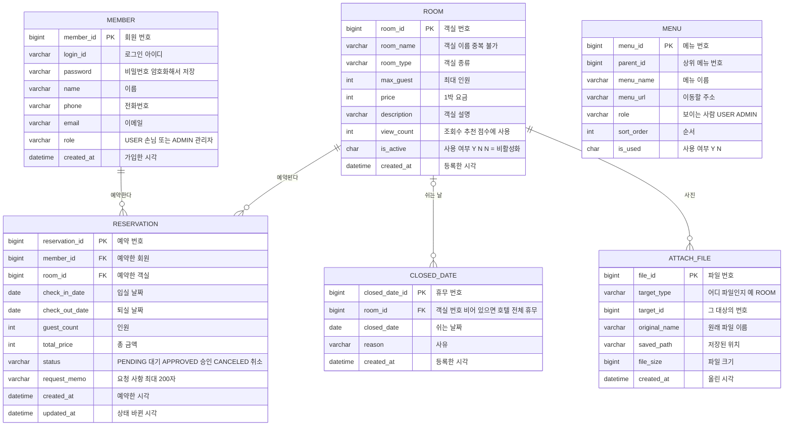

**손님 예약 흐름**: ROOM-001 객실 추천 → RSV-001 객실 예약 → RSV-002 예약 완료 → ADM-003 관리자 승인

DDL은 [`hotel_reservation_ddl.sql`](./hotel_reservation_ddl.sql) 참고 (MySQL / MariaDB).

---

## 1. 회원 테이블 · 객실 추천 화면

### DB 설계

손님 명부예요. role 칸으로 손님(USER)과 관리자(ADMIN)를 나눠서, 관리자 화면은 ADMIN만 들어갈 수 있게 해요. 비밀번호는 알아볼 수 없게 바꿔서 저장해요.

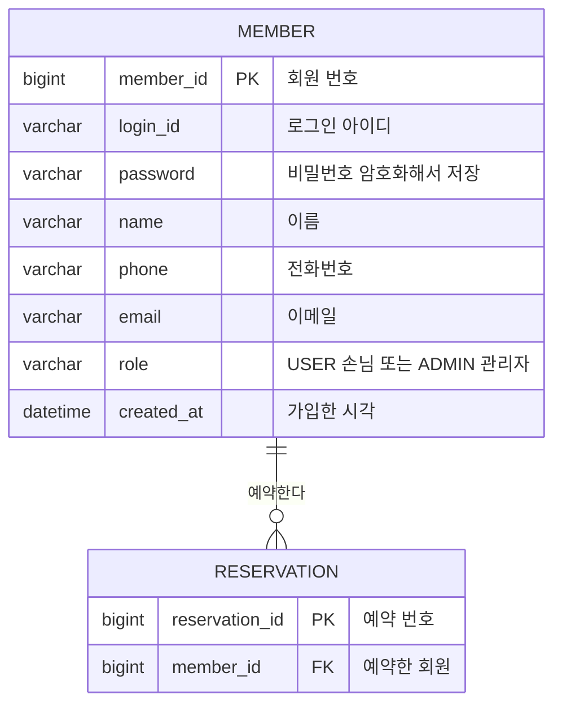

#### `MEMBER` 회원 테이블

| 컬럼 | 타입 | 키 | 설명 |
|---|---|---|---|
| `member_id` | bigint | PK | 회원 번호 |
| `login_id` | varchar |  | 로그인 아이디 |
| `password` | varchar |  | 비밀번호 (암호화해서 저장) |
| `name` | varchar |  | 이름 |
| `phone` | varchar |  | 전화번호 |
| `email` | varchar |  | 이메일 |
| `role` | varchar |  | USER(손님) 또는 ADMIN(관리자) |
| `created_at` | datetime |  | 가입한 시각 |

### 화면 설계서

#### ROOM-001 객실 추천 화면

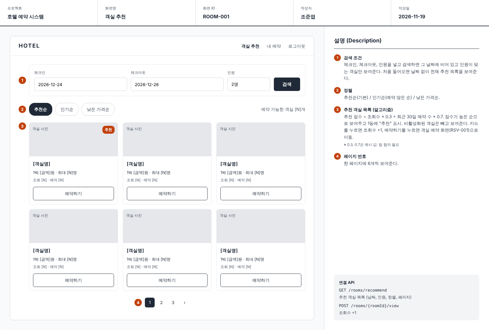

- **① 검색 조건**: 체크인, 체크아웃, 인원을 넣으면 그 날짜에 비어 있고 인원이 맞는 객실만 보여준다.
- **② 정렬**: 추천순(기본) / 인기순(예약 많은 순) / 낮은 가격순.
- **③ 추천 객실 목록**: 추천 점수 = 조회수 × 0.3 + 최근 30일 예약 수 × 0.7. 1등에 "추천" 표시, 비활성 객실 제외. 카드 클릭 시 조회수 +1, 예약하기 → RSV-001. *(0.3, 0.7은 예시 값, 팀 협의 필요)*
- **④ 페이지 번호**: 한 페이지에 6개.
- **연결 API**: `GET /rooms/recommend`, `POST /rooms/{roomId}/view`

---

## 2. 객실 테이블 · 관리자 객실 관리 화면

### DB 설계

방 안내 카드 묶음이에요. view_count(조회수)는 추천 점수에 쓰이고, is_active로 방을 지우지 않고 숨겨요(비활성화). 지우면 예전 예약 기록이 망가지기 때문이에요.

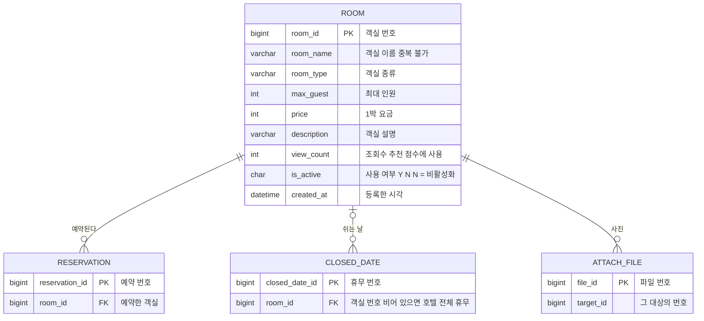

#### `ROOM` 객실 테이블

| 컬럼 | 타입 | 키 | 설명 |
|---|---|---|---|
| `room_id` | bigint | PK | 객실 번호 |
| `room_name` | varchar |  | 객실 이름 (중복 불가) |
| `room_type` | varchar |  | 객실 종류 |
| `max_guest` | int |  | 최대 인원 |
| `price` | int |  | 1박 요금 |
| `description` | varchar |  | 객실 설명 |
| `view_count` | int |  | 조회수 (추천 점수에 사용) |
| `is_active` | char |  | 사용 여부 Y / N (N = 비활성화) |
| `created_at` | datetime |  | 등록한 시각 |

### 화면 설계서

#### ADM-001 관리자) 객실 관리 화면

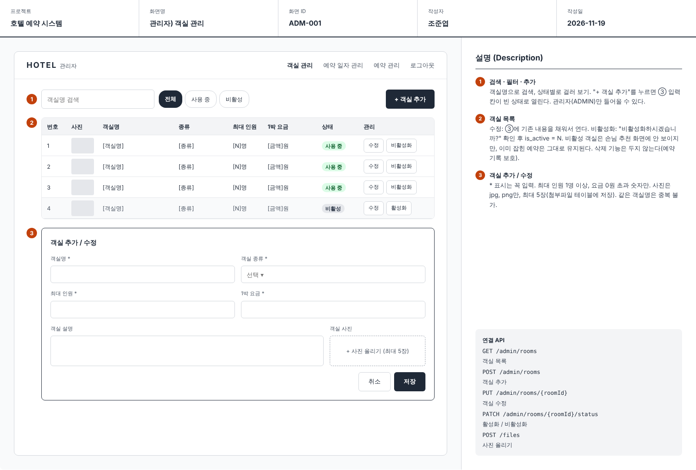

- **① 검색 · 필터 · 추가**: 객실명 검색, 상태별 보기. ADMIN만 접근.
- **② 객실 목록**: 수정 / 비활성화(is_active = N). 비활성 객실은 손님 화면에서 숨김, 기존 예약은 유지. 삭제 기능 없음.
- **③ 객실 추가 / 수정**: * 필수. 최대 인원 1 이상, 요금 0 초과. 사진 jpg·png 최대 5장. 객실명 중복 불가.
- **연결 API**: `GET /admin/rooms`, `POST /admin/rooms`, `PUT /admin/rooms/{roomId}`, `PATCH /admin/rooms/{roomId}/status`, `POST /files`

---

## 3. 예약 일자 테이블 · 관리자 예약 일자 관리 화면

### DB 설계

달력에 휴무일을 표시하는 메모장이에요. room_id를 비우면 호텔 전체 휴무, 방 번호를 적으면 그 방만 휴무예요. 손님 예약 화면 달력이 이 표를 보고 휴무일을 막아요.

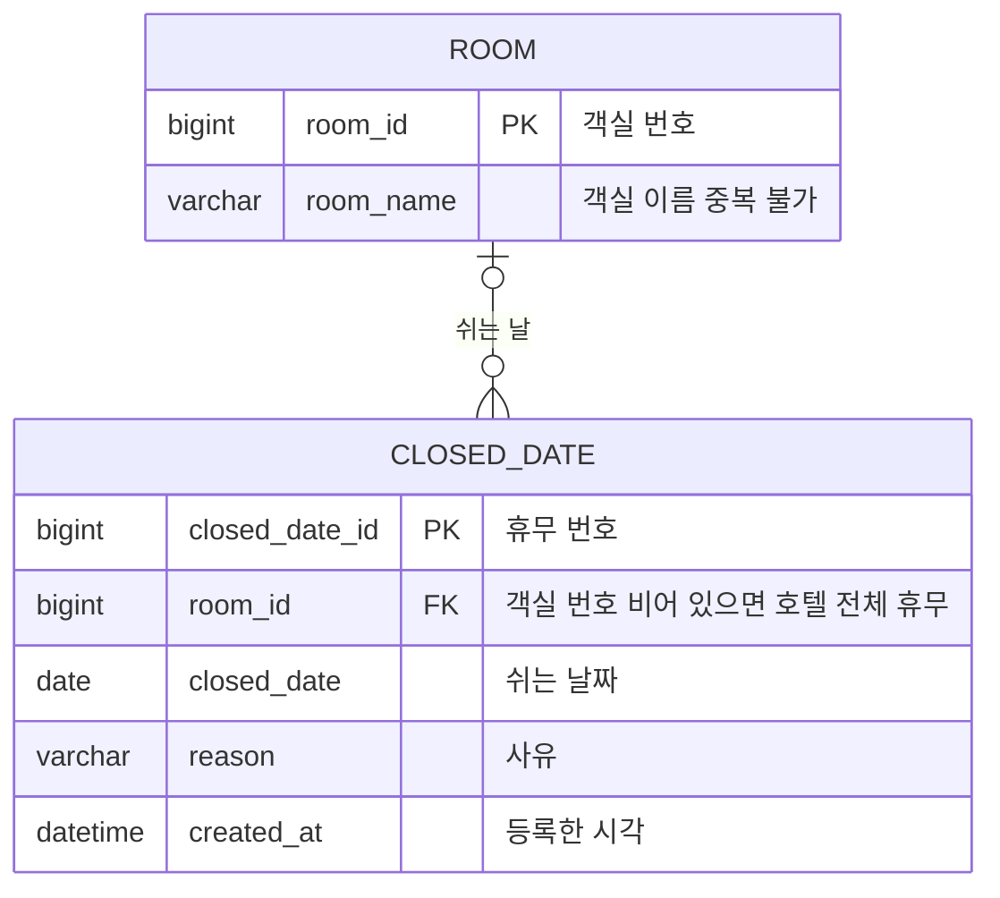

#### `CLOSED_DATE` 예약 일자 (휴무일) 테이블

| 컬럼 | 타입 | 키 | 설명 |
|---|---|---|---|
| `closed_date_id` | bigint | PK | 휴무 번호 |
| `room_id` | bigint | FK | 객실 번호 (비어 있으면 호텔 전체 휴무) |
| `closed_date` | date |  | 쉬는 날짜 |
| `reason` | varchar |  | 사유 |
| `created_at` | datetime |  | 등록한 시각 |

### 화면 설계서

#### ADM-002 관리자) 예약 일자 관리 화면

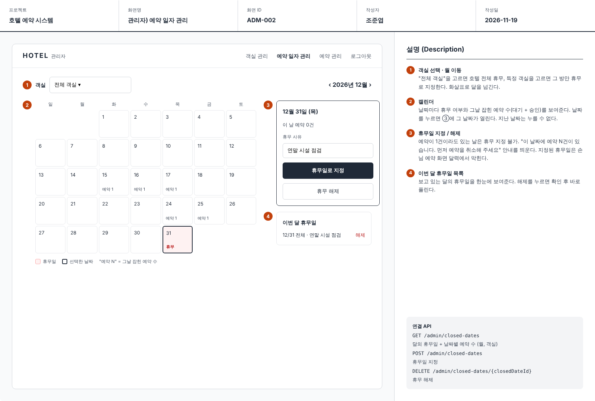

- **① 객실 선택 · 월 이동**: 전체 객실 = 호텔 전체 휴무, 특정 객실 = 그 방만 휴무.
- **② 캘린더**: 날짜별 휴무 여부와 예약 수(대기 + 승인). 지난 날짜는 선택 불가.
- **③ 휴무일 지정 / 해제**: 예약이 1건이라도 있으면 지정 불가. *(팀 협의 필요)*
- **④ 이번 달 휴무일 목록**: 바로 해제 가능.
- **연결 API**: `GET /admin/closed-dates`, `POST /admin/closed-dates`, `DELETE /admin/closed-dates/{closedDateId}`

---

## 4. 객실 예약 테이블 · 객실 예약 화면

### DB 설계

예약 장부예요. 누가, 어느 방을, 언제부터 언제까지, 몇 명이, 얼마에 예약했는지 적어요. status는 PENDING(대기)으로 시작해서 관리자가 APPROVED(승인) 또는 CANCELED(취소)로 바꿔요.

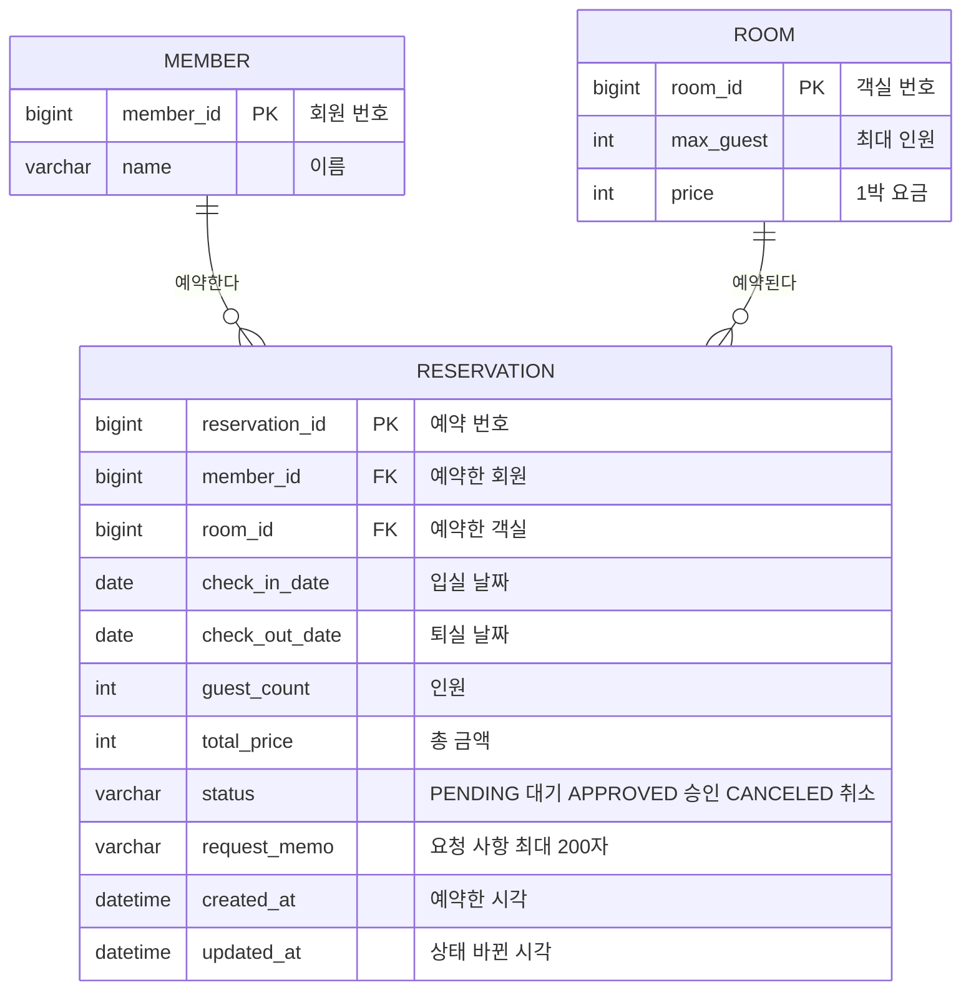

#### `RESERVATION` 객실 예약 테이블

| 컬럼 | 타입 | 키 | 설명 |
|---|---|---|---|
| `reservation_id` | bigint | PK | 예약 번호 |
| `member_id` | bigint | FK | 예약한 회원 |
| `room_id` | bigint | FK | 예약한 객실 |
| `check_in_date` | date |  | 입실 날짜 |
| `check_out_date` | date |  | 퇴실 날짜 |
| `guest_count` | int |  | 인원 |
| `total_price` | int |  | 총 금액 |
| `status` | varchar |  | PENDING(대기) / APPROVED(승인) / CANCELED(취소) |
| `request_memo` | varchar |  | 요청 사항 (최대 200자) |
| `created_at` | datetime |  | 예약한 시각 |
| `updated_at` | datetime |  | 상태 바뀐 시각 |

### 화면 설계서

#### RSV-001 객실 예약 화면

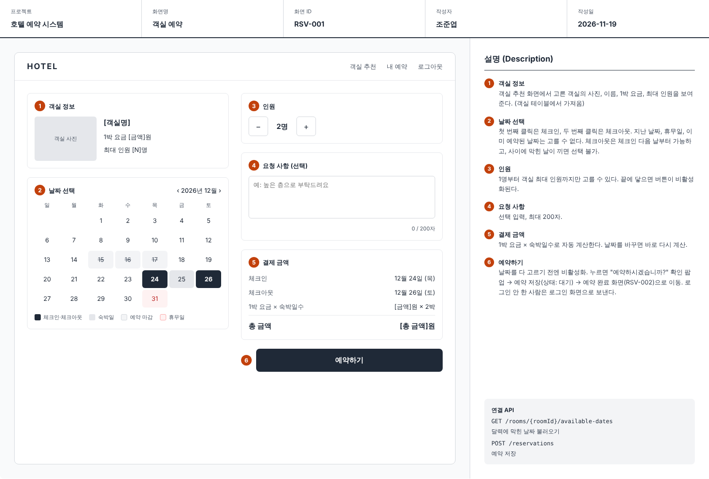

- **① 객실 정보**: 추천 화면에서 고른 객실의 사진, 이름, 1박 요금, 최대 인원.
- **② 날짜 선택**: 지난 날짜, 휴무일, 이미 예약된 날짜는 선택 불가. 체크아웃은 체크인 다음 날부터.
- **③ 인원**: 1명 ~ 객실 최대 인원.
- **④ 요청 사항**: 선택 입력, 최대 200자.
- **⑤ 결제 금액**: 1박 요금 × 숙박일수 자동 계산.
- **⑥ 예약하기**: 확인 팝업 → 저장(상태: PENDING) → RSV-002. 비로그인 시 로그인 화면으로.
- **연결 API**: `GET /rooms/{roomId}/available-dates`, `POST /reservations`

#### RSV-002 예약 완료 화면

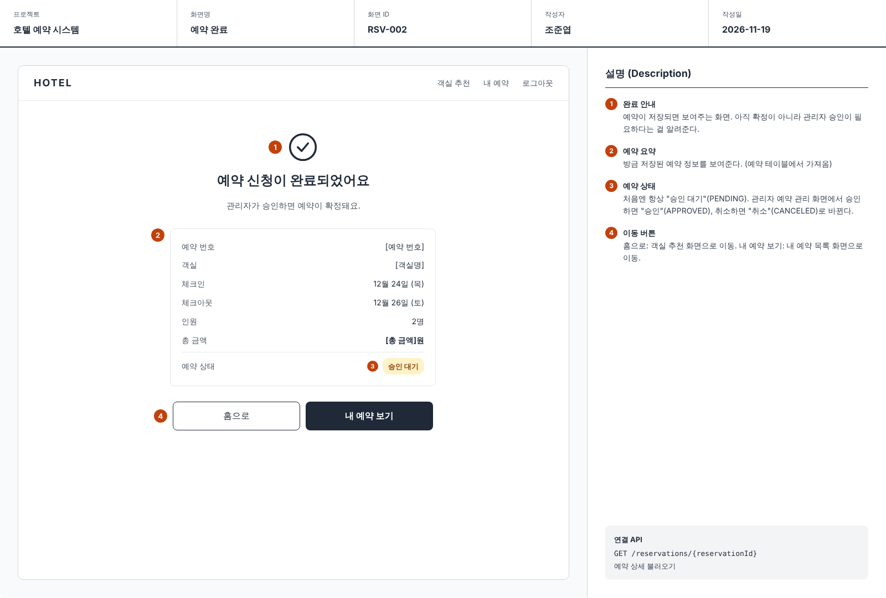

- **① 완료 안내**: 관리자 승인 후 확정된다는 안내.
- **② 예약 요약**: 방금 저장된 예약 정보.
- **③ 예약 상태**: 처음엔 항상 "승인 대기"(PENDING).
- **④ 이동 버튼**: 홈으로(ROOM-001), 내 예약 보기.
- **연결 API**: `GET /reservations/{reservationId}`

---

## 5. 공통 테이블 · 관리자 예약 관리 화면

### DB 설계

여러 화면이 같이 쓰는 서랍이에요. 첨부파일은 target_type과 target_id 이름표로 주인을 적어서 어떤 파일이든 담고, 메뉴는 화면 위쪽 메뉴를 표로 관리해요. parent_id로 큰 메뉴 안에 작은 메뉴를 넣어요.

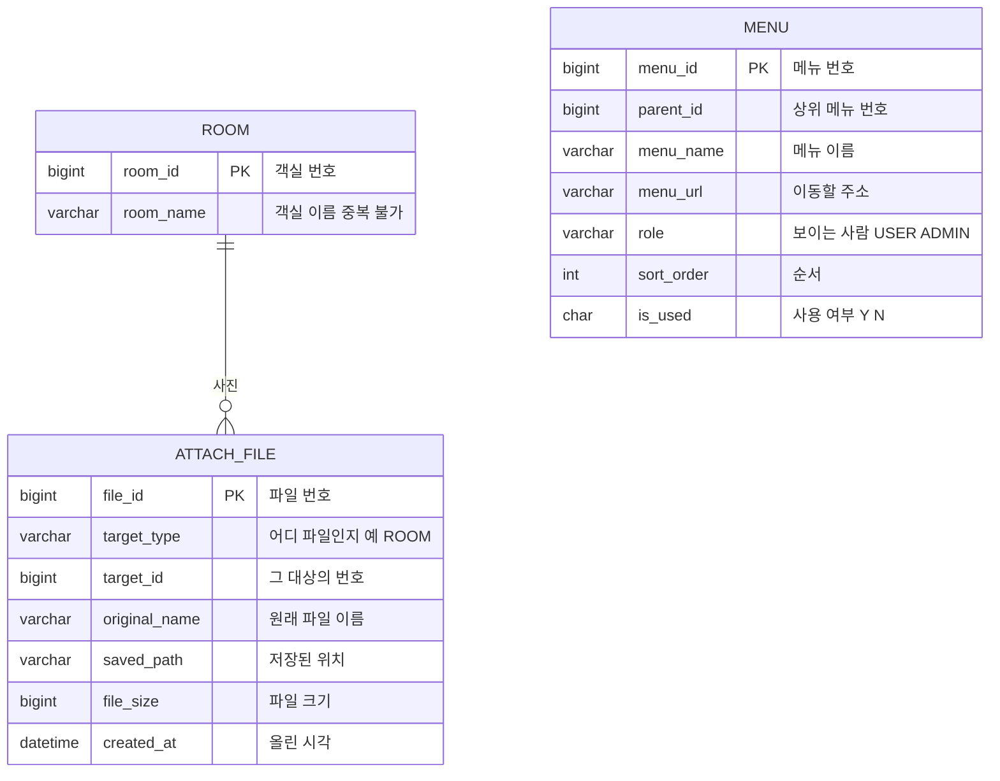

#### `ATTACH_FILE` 첨부파일 (공통) 테이블

| 컬럼 | 타입 | 키 | 설명 |
|---|---|---|---|
| `file_id` | bigint | PK | 파일 번호 |
| `target_type` | varchar |  | 어디 파일인지 (예: ROOM) |
| `target_id` | bigint |  | 그 대상의 번호 |
| `original_name` | varchar |  | 원래 파일 이름 |
| `saved_path` | varchar |  | 저장된 위치 |
| `file_size` | bigint |  | 파일 크기 |
| `created_at` | datetime |  | 올린 시각 |

#### `MENU` 메뉴 (공통) 테이블

| 컬럼 | 타입 | 키 | 설명 |
|---|---|---|---|
| `menu_id` | bigint | PK | 메뉴 번호 |
| `parent_id` | bigint |  | 상위 메뉴 번호 |
| `menu_name` | varchar |  | 메뉴 이름 |
| `menu_url` | varchar |  | 이동할 주소 |
| `role` | varchar |  | 보이는 사람 (USER / ADMIN) |
| `sort_order` | int |  | 순서 |
| `is_used` | char |  | 사용 여부 Y / N |

### 화면 설계서

#### ADM-003 관리자) 예약 관리 화면

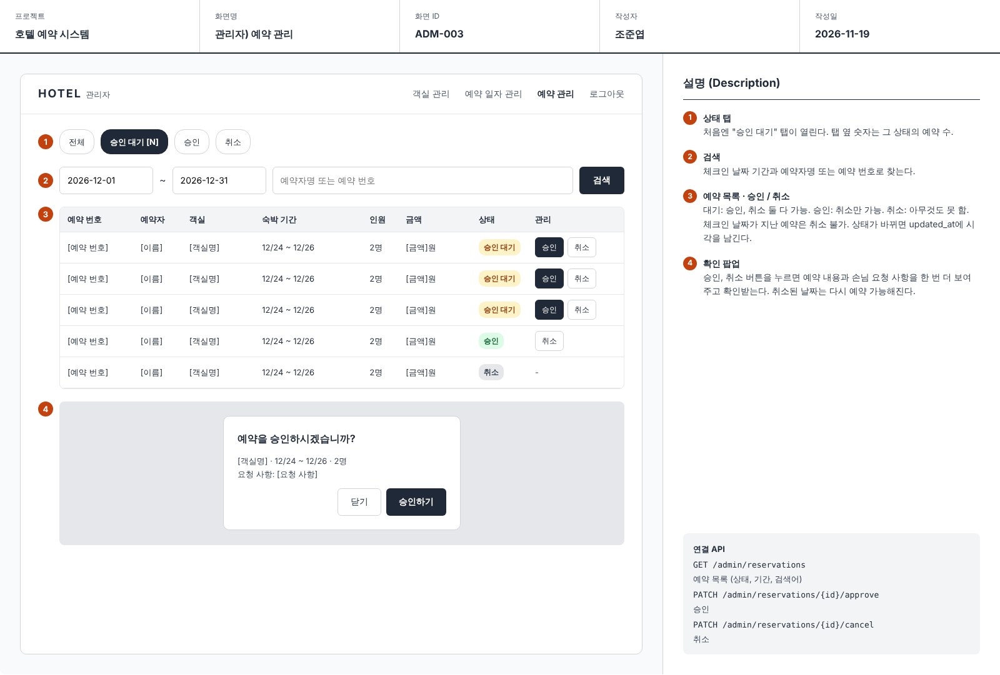

- **① 상태 탭**: 전체 / 승인 대기 / 승인 / 취소. 기본은 승인 대기.
- **② 검색**: 체크인 기간, 예약자명 또는 예약 번호.
- **③ 승인 / 취소**: 대기 → 승인·취소 가능, 승인 → 취소만, 취소 → 불가. 체크인 지난 예약은 취소 불가. 변경 시 updated_at 기록.
- **④ 확인 팝업**: 예약 내용과 요청 사항을 다시 보여주고 확인.
- **연결 API**: `GET /admin/reservations`, `PATCH /admin/reservations/{id}/approve`, `PATCH /admin/reservations/{id}/cancel`
