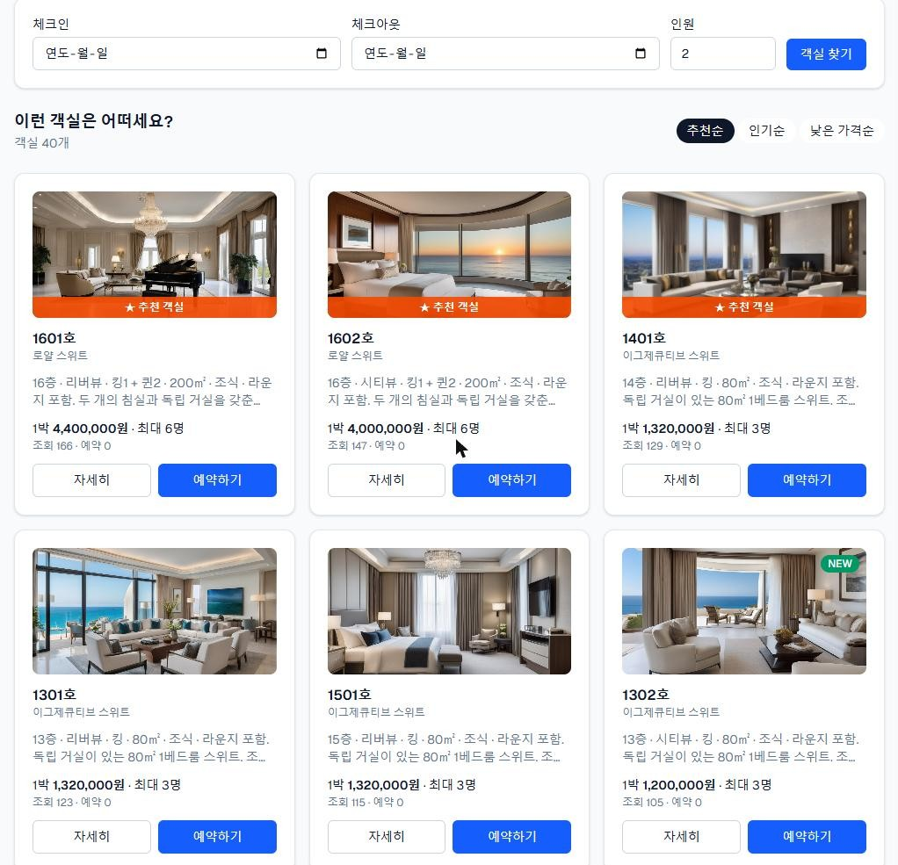
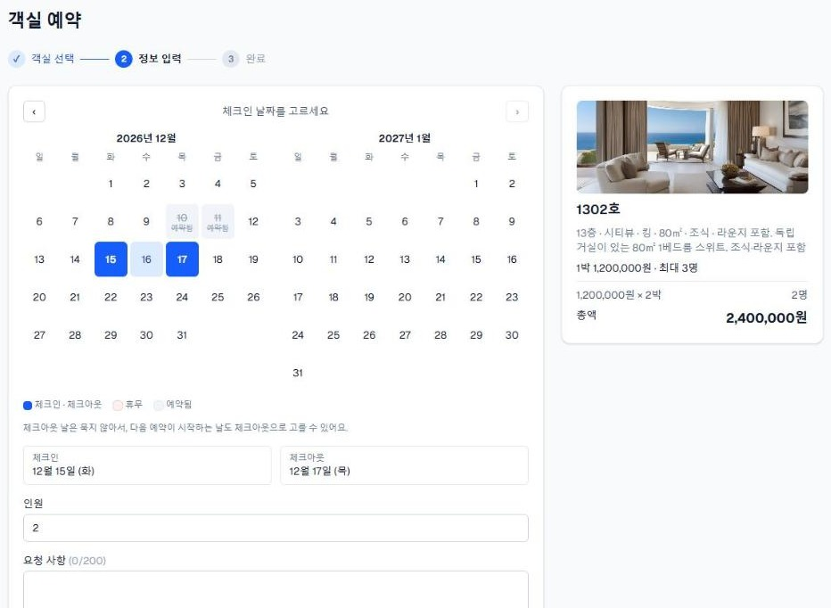
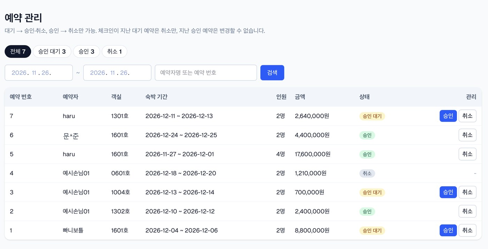
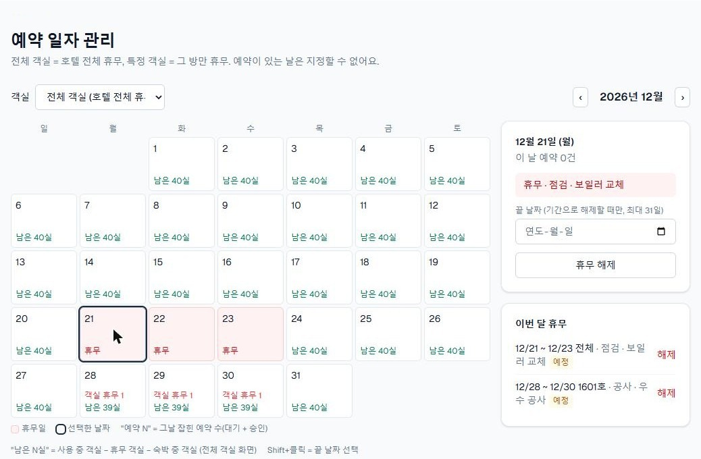
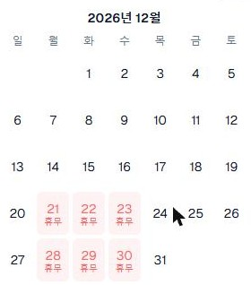
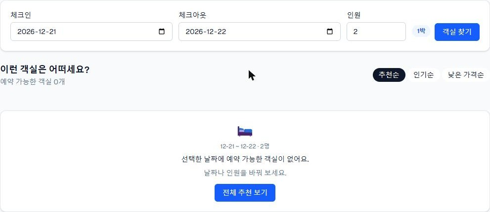
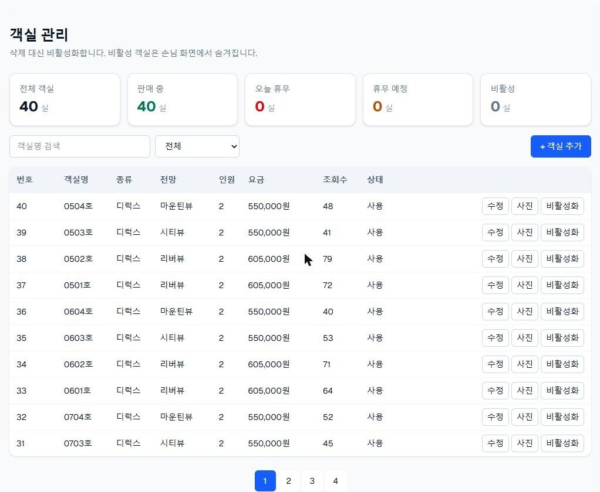

# 태양의 호텔 (Hotel Sol) — 프로젝트 통합 보고서

3기 바이브코딩 해커톤(2026-11-19 ~ 11-26) 5인 팀 프로젝트의 기록입니다. 발표 자료, 파트별 발표 · 회고 자료, 개발 문서를 한곳에 모았습니다. 처음 보는 사람이 **무엇을 만들었고, 어떻게 만들었고, 무엇을 배웠는지** 이 문서 하나로 알 수 있게 쓰는 것이 목표입니다.

- 기준: main, 2026-11-26 (제출 · 발표일). 이후 코드가 바뀌면 [DevelopDoc](../../DevelopDoc/)이 최신입니다.
- 사람 이름 대신 **파트 번호**로 적습니다(1번 ~ 5번).

## 목차
1. [한눈에 보기](#1-한눈에-보기)
2. [문제와 목표](#2-문제와-목표)
3. [화면별 결과 (파트별)](#3-화면별-결과-파트별)
4. [핵심 규칙](#4-핵심-규칙)
5. [구조 · DB · 배포](#5-구조--db--배포)
6. [개발 과정](#6-개발-과정)
7. [품질과 보안](#7-품질과-보안)
8. [회고 — 파트별 · 팀 공통](#8-회고--파트별--팀-공통)
9. [다음 단계](#9-다음-단계)
10. [자료 위치](#10-자료-위치)

---

## 1. 한눈에 보기

| 항목 | 내용 |
|---|---|
| 한 줄 소개 | 날짜와 인원만 넣으면 **예약 가능한 객실을 추천받아 바로 예약**하고, 관리자는 **객실 · 휴무일 · 예약 승인**을 한 곳에서 관리하는 호텔 예약 서비스 |
| 시연 주소 | 화면 https://hotel-reservation-ten-phi.vercel.app · API https://hotel-sol-api.onrender.com (무료 서버라 첫 접속은 30초~1분 걸릴 수 있음) |
| 기술 | Next.js 16 · React 19 · Tailwind CSS / FastAPI · SQLAlchemy 2 (Python 3.12) / Supabase PostgreSQL 17 · Storage |
| 배포 | Vercel(화면) + Render(백엔드), `main`에 반영하면 자동 배포 |
| 규모 | 5개 파트, DB 테이블 10개, 시연용 객실 40개(사진은 AI 생성) |
| 협업 기록 | merge된 PR 88개, 이슈 15개(모두 해결), Discussion 8개 |
| 품질 | 백엔드 자동 테스트 200개 모두 통과, 실제 화면 테스트 전 항목 통과([RELEASE_TEST](../../DevelopDoc/RELEASE_TEST.md)) |

## 2. 문제와 목표

**손님의 불편** — 날짜를 바꿔 가며 객실을 하나씩 확인해야 하고, 어떤 방이 인기 있는지 알기 어렵습니다.
**관리자의 불편** — 객실 정보, 공사 · 점검으로 쉬는 날, 예약 승인이 따로 관리되어 쉬는 날에 예약이 들어오는 등 실수가 생기기 쉽습니다.

| 목표 | 결과 |
|---|---|
| ① 바로 예약 | 날짜 · 인원만으로 예약 가능한 객실을 추천받고 그 자리에서 예약 신청 |
| ② 자동으로 막기 | 관리자가 지정한 휴무일은 추천 · 예약에서 자동으로 막힘 (서버와 DB가 이중으로 검사) |
| ③ 바로 반영 | 관리자가 승인 · 취소하면 손님의 내 예약에 바로 반영 |

**하지 않은 것(범위 밖):** 결제, 성수기 요금, 회원 등급 · 할인, 이메일 · 문자 알림, 다국어, 손님 직접 취소(팀 결정: 취소는 관리자만).

## 3. 화면별 결과 (파트별)

예약 흐름 순서(손님 → 관리자)로 적습니다. 화면 캡처는 배포 사이트 기준입니다.

### 1번 · 객실 추천 · 회원 — `/rooms` · `/rooms/{id}` · `/signup` · `/login` · `/mypage`



- **예약 가능한 방만 추천** — 날짜 · 인원으로 휴무 · 예약 겹침 · 기간 제한을 걸러 냄
- **추천 점수 0~100** — 조회 40% + 최근 30일 **승인** 예약 60%(각 최대값 대비). 1~3위 "★ 추천", HOT · NEW 뱃지. 실제 예약을 둘러보기보다 믿을 만한 신호로 보고 크게 반영
- **회원** — 가입(아이디 중복 확인, 전화번호 필수) · 로그인 · 내 정보 수정 · 비밀번호 변경 · 탈퇴
- **보안** — 10분 안에 5번 틀리면 10분 잠금(DB에 기록해 서버를 다시 켜도 유지, 성공한 적 있는 기기는 따로 셈). 조회수는 같은 사람 · 같은 방 하루 1번. 메일 인증이 없어 **비밀번호 찾기는 일부러 꺼 둠**(남이 계정을 가져가지 못하게, 프런트 문의 안내)

### 4번 · 객실 예약 · 예약 완료 — `/reservation/new` · `/reservation/{id}/complete` · `/reservation/list`



- **예약 달력** — 지난 날 · 휴무 · 예약된 날은 처음부터 막힘. 한 번에 최대 6박, 체크인은 오늘부터 30일 안
- **서버가 계산한 금액** — 견적과 저장이 같은 함수(1박 요금 × 박수), 예약할 때 1박 요금도 저장해 나중에 요금이 바뀌어도 받은 금액은 그대로
- **막힌 이유별 안내** — 휴무 · 판매 중지 · 겹침 · 인원 초과 등 8가지 코드와 한국어 문장. 여러 이유가 겹치면 호텔 휴무 → 객실 판매 중지 → 예약 겹침 순서로 하나만
- **공정한 예약** — 같은 방 · 같은 날을 동시에 눌러도 한 명만 성공(회원 → 객실 순서로 잠가 교착 없음), 승인 대기 예약은 1인 3건까지(가짜 예약으로 방을 막는 악용 방지)

### 5번 · 관리자 예약 관리 · 공통 — `/admin/reservations` · 상단 메뉴



- **상태 흐름** — 승인 대기 → 승인 → 취소, 승인 대기 → 취소. 대기는 [승인][취소], 승인은 [취소]만 보임
- **상태 탭 · 검색** — 상태별 건수 탭, 기간 · 예약자명 · 예약 번호 검색
- **승인 · 취소** — 확인 팝업, 취소하면 언제 · 누가 취소했는지 기록. 체크인이 지난 대기는 취소만, 지난 승인은 변경 불가
- **동시에 눌러도 안전** — 예약 행을 잠가, A가 취소하는 동안 B의 승인은 기다렸다가 409(이미 취소된 예약)
- **공통** — 역할별 메뉴(DB 메뉴 표), 관리자 ↔ 고객 화면 전환 버튼

### 3번 · 예약 일자(휴무) 관리 — `/admin/closed-dates` (팀장 · DB 담당)



| 손님 예약 달력 — 휴무일 막힘 | 그 날짜 추천 — 객실 0개 |
|---|---|
|  |  |

- **달력 한눈에** — 날짜마다 휴무 · 예약 수 · 남은 객실
- **호텔 전체 / 객실별 휴무** — 기간 최대 31일, 사유 분류 5개(공사 · 점검 · 행사 · 휴관 · 기타) + 상세. 예약이 있는 날은 409로 거절
- **휴무 묶음** — 한 번에 지정한 기간을 묶음 하나로 관리, 예정 · 진행 중 · 종료로 보고 묶음째 해제, 지정한 관리자 기록
- **손님 화면에서 바로 막힘** — 추천 0개, 예약 달력 "휴무", 예약 신청 409

### 2번 · 관리자 객실 관리 — `/admin/rooms`



- **요약 카드** — 전체 · 판매 중 · 오늘 휴무 · 휴무 예정 · 비활성(휴무는 3번과 연결)
- **등급을 고르면 자동** — 등급 테이블(4개)에서 요금 · 인원 · 침대 · 설명을 채움, 리버뷰 +10%
- **삭제 대신 비활성화** — 지난 예약 기록은 남기고 손님 화면에서만 숨김. 앞으로 묵을 예약이 있으면 막고 이유 안내. 예약 있는 방은 요금 · 인원 · 종류 수정 불가(이름 · 설명 · 전망은 가능)
- **사진** — jpg · png만(파일 내용까지 확인) · 5MB · 객실당 5장, Supabase 공용 저장소, 첫 장이 대표 사진
- **시연 데이터** — 객실 40개 · AI 생성 객실 사진

## 4. 핵심 규칙

| 규칙 | 내용 |
|---|---|
| 예약 범위 | 한 번에 최대 6박, 체크인은 오늘부터 30일 안(추천 · 상세 · 예약 공통), 승인 대기 1인 3건 |
| 체크아웃 날 | 묵지 않는 날이라 그날 다른 손님이 체크인 가능 |
| 휴무 | `room_id` 없음 = 호텔 전체, 있음 = 그 방만. 예약이 있는 날은 지정 불가 |
| 이중 예약 | 서버 검사 + DB `EXCLUDE` 제약으로 한 번 더 막음 |
| 금액 | 서버 한 곳에서만 계산, 1박 요금 기록 |
| 오류 | 모두 한국어 `message` + 코드(`DATE_CLOSED`, `ROOM_NOT_AVAILABLE`, `TOO_MANY_PENDING` …). 전체 목록은 [TECH_SPEC 6절](../../DevelopDoc/TECH_SPEC.md) |

## 5. 구조 · DB · 배포

```
손님 · 관리자(브라우저) → Next.js 화면 → /api → FastAPI 백엔드 → Supabase PostgreSQL · Storage
```

- **모노레포** — `frontend/`(Next.js, 화면만) + `backend/`(FastAPI, 모든 로직). 자세한 그림은 [ARCHITECTURE](../ARCHITECTURE.md)
- **DB 테이블 10개** — 회원 · 객실 · 등급 · 사진 · 예약 · 휴무 날짜 · 휴무 묶음 · 조회 기록 · 로그인 실패 기록 · 메뉴. 정의는 [hotel_reservation_ddl.sql](../hotel_reservation_ddl.sql)
- **DB 하나를 5명이 공유** — 스키마로 나눔: 공용 `hotel`(시연), 각자 `hotel_<이름>`, 테스트 `<스키마>_test`. 공용을 다시 만들려면 별도 플래그가 필요
- **배포** — Vercel(root `frontend`) + Render(root `backend`, `APP_ENV=production`, 32자 이상 무작위 세션 비밀키가 없으면 서버가 시작하지 않음). 둘 다 HTTPS

## 6. 개발 과정

### 일정

| 날짜 | 단계 | 한 일 |
|---|---|---|
| 11-19 (목) | 기획 · 설계 | 팀 빌딩 · 주제 확정, 파트별 설계서, ERD · DB 테이블 정의 |
| 11-23 (월) | Step 1 · 뼈대 | 모노레포(Next.js + FastAPI), DB를 Supabase로 확정, 파트별 핵심 화면 · API |
| 11-24 (화) | Step 2 · 점검 | 기능 완성(DB 변경 없음), 보안 · 완성도 1차 점검, 파트별 개선안을 Discussion에 제안 |
| 11-25 (수) | Step 3 · 동결 | DB 구조 한 번에 개선 → 파트별 반영, 보안 이슈 수정, 실제 화면 최종 테스트, 배포 |
| 11-26 (목) | 제출 · 발표 | 10:00 제출, 오후 발표 |

### 바뀐 결정들
- **DB** — 처음 계획(개인 MSSQL) → 개인 개발은 로컬 MariaDB → 5명이 함께 쓰는 **Supabase**로 확정(11-23 밤)
- **초기 기획 · Step 1** — 첫 팀장(4번)이 초기 기획과 Step 1 구성을 맡음
- **진행 방식** — 모두 같은 속도로 만들 수 없어서 "프로토타입(뼈대) 먼저 → 진행 보고 → 다음 방향"으로 바꾸고 Step 1 · 2 · 3으로 나눔
- **팀장** — 11-23에 교대(3번 파트가 이어받음), 이후 DB 변경까지 담당
- **브랜치 규칙** — 5번이 제안한 `main` · `dev` · `feature/*` 구조 · 진행 순서를 팀이 상의해 채택. dev에서 main(배포)으로 바로 올린 것은 최초 런칭하는 소규모 프로젝트라 이번만 허용한 예외. 보호 규칙(ruleset)을 붙였다가 merge 오류가 많아 같은 날 떼고 "약속으로 지키기"로 운영
- **PR 흐름** — "알아서 올리기"(main · dev에 직접 반영되는 일이 생김) → "모두 브랜치 + PR" → **"팀원은 PR까지, 확인 · merge는 팀장"**(순서대로 merge하며 매번 전체 테스트)

### DB 변경을 한 번에 (Step 3, Discussion #60)
1. **추가** — 새 테이블 · 새 칸을 NULL 허용으로 더하고 시드 수정, 테스트 데이터는 도우미 함수로만 넣게 정리(PR #64)
2. **파트별 코드** — 5명이 각자 반영, 충돌 점검 후 순서대로 merge
3. **강화** — NOT NULL · CHECK, 이중 예약 `EXCLUDE` 제약, 옛 칸 · 인덱스 삭제(PR #83)
4. **공용 DB 다시 만들기** — main 기준 시연 데이터 재생성

### 사람과 AI의 역할
- **사람** — 방향 · 규칙 · 결정(무엇을 만들지, 어떤 PR을 적용할지, 누구에게 맡길지), 최종 점검
- **AI 에이전트(각자 1개씩)** — 설계 초안 · 구현 · 테스트 · 코드 검토
- 모든 변경은 브랜치 → PR → 리뷰 → `dev` → `main`. 제안은 Discussions, 문제는 Issues로 남김

## 7. 품질과 보안

- **자동 테스트** — 백엔드 200개 통과(11-24에는 77개). 화면은 `tsc` · `eslint` · `next build` 통과
- **실제 화면 테스트** — 손님 · 회원 · 관리자 · 공통 시나리오 전 항목 통과, 서버 500 · 콘솔 오류 0건([RELEASE_TEST](../../DevelopDoc/RELEASE_TEST.md))
- **보안 점검(11-25, 파트별 이슈)**

| 이슈 | 파트 | 문제 → 조치 |
|---|---|---|
| #66 | 3번 | 휴무 지정과 예약이 엇갈릴 수 있음 · 입력 길이 → 객실 행 잠금, 연도 · 길이 · 기간 제한 |
| #67 | 1번 | 이메일만 알면 비밀번호를 바꿀 수 있음(HIGH) → 비밀번호 찾기 끔, 탈퇴 아이디 정리 |
| #68 | 4번 | 승인 대기 예약 무제한 → 1인 3건 |
| #69 | 2번 | 요금 상한 · 사진 동시 업로드 경합 → 상한, 잠금 |
| #70 | 5번 | 상태 확인 API가 DB 버전 노출 · 약한 세션 비밀키 → 버전 숨김, 배포 환경에서 시작 거부 |

- **비밀값** — `.env`는 저장소에 없음(`.env.example`만). 해커톤 뒤 DB · 관리자 비밀번호와 Storage 키 교체 예정

## 8. 회고 — 파트별 · 팀 공통

### 파트별 한 줄

| 파트 | 어려웠던 점 | 잘한 점 | 배운 점 · 아쉬운 점 |
|---|---|---|---|
| 1번 | 비전공자로 처음 해 보는 팀 프로젝트, 브랜치 · PR · 리뷰 따라가기 | 추천 공식을 직접 설계해 구현, 보안 지적 4가지를 하루 안에 수정 | 메일 인증이 없어 비밀번호 찾기를 끈 것, AI 없이도 해낼 실력을 채워야 함 |
| 2번 | 낯선 용어와 구조 속에서 팀원과 AI 사이의 전달자('인간 라우터') | AI에게 질문하는 능력이 늘었음 | 개발이 처음이라 모든 것이 새로웠던 경험 |
| 3번 | 팀원 → 팀장, 갈등 중재, PR · merge 흐름 정리, 동시에 오는 의견 조율 | Branch · Issue · Discussion · Comment를 팀이 함께 써 봄 | 규칙을 처음부터 정하지 못함. 협업은 서로 다름을 이해하는 데서 시작 |
| 4번 | "겹치나?"만 보고 "누가 얼마나 잡고 있나?"를 놓쳐 대기 예약 상한을 뒤늦게 넣음 | 막힌 이유 8가지 안내, 동시 예약 처리 | 동작하는 것과 악용될 수 있는가는 다른 문제. 방향을 정하는 건 결국 사람 |
| 5번 | 5명이 각자 AI로 한 저장소에서 개발 → PR 홍수 · 충돌 · 리뷰 피로 | 3일 만에 기획부터 테스트까지 완주, 예약 규칙을 서버가 검사하는 구조 | 공통 뼈대 없이 동시에 시작, 규칙이 README에만 있어 강제되지 않음. 다음은 MCP 서버로 AI 에이전트도 검색 · 예약할 수 있는 "AI도 쓰는 서비스" |

### 팀 공통 (Keep · Problem · Try)
- **Keep** — AI로 3일 만에 기획부터 테스트까지, 브랜치 규칙 · 개발 문서 · 사람별 DB, 예약 규칙을 서버가 검사하는 구조
- **Problem** — AI가 PR을 쏟아내 충돌 · 리뷰 피로, 공통 뼈대 없이 동시에 시작, 규칙은 문서에만 있고 강제 장치 없음. 충돌은 프론트 API 타입 · 관리자 API 호출 · 객실 API 같은 "계약 파일"에 몰림
- **Try** — 루트 `CLAUDE.md`에 팀 규칙(AI가 자동으로 읽게), 보호 규칙 · CI · CODEOWNERS로 강제, Day 1에 공통 뼈대 + API 명세 먼저, MCP로 AI 에이전트에게도 예약 열기

> 협업 속도는 AI가, 품질은 규칙이. — 5번 파트 통합 회고에서

## 9. 다음 단계
1. 성수기 기간 · 요금, 판매 제한(도착 불가 · 최소 숙박 등)
2. 메일 인증으로 비밀번호 찾기 다시 열기
3. CI(자동 검사) · 보호 규칙 재적용 · 팀 규칙을 AI 규칙 파일로
4. **MCP 서버** — 기존 API 위에 도구 6개(객실 검색 · 상세 · 예약 가능 날짜 · 견적 · 예약 신청 · 내 예약)를 얹어 AI 에이전트도 대화로 예약 신청
5. 휴무 · 해제 이력, 회원 할인 · 객실 유형 필터 (후보 목록: [WORK_UNITS 3-B](../../DevelopDoc/WORK_UNITS.md))

## 10. 자료 위치

| 자료 | 위치 |
|---|---|
| 팀 발표 자료(13쪽) | [docs/presentation/0_team_발표자료_최종.pdf](../presentation/0_team_발표자료_최종.pdf) |
| 파트별 발표 · 회고 | [docs/presentation/](../presentation/) — 1번(대본 포함) · 2번(`5_part2_*`) · 3번 · 4번 · 5번(통합 회고 `Part_5_*`) |
| 개발 문서 | [PRD](../../DevelopDoc/PRD.md) · [TECH_SPEC](../../DevelopDoc/TECH_SPEC.md) · [WORK_UNITS](../../DevelopDoc/WORK_UNITS.md) · [FINAL_CHECKLIST](../../DevelopDoc/FINAL_CHECKLIST.md) · [RELEASE_TEST](../../DevelopDoc/RELEASE_TEST.md) |
| 구조 그림 | [docs/ARCHITECTURE.md](../ARCHITECTURE.md) |
| 과거 설계 자료 | [docs/archive/](../archive/) |
| 논의 기록 | GitHub Discussions #51 ~ #60 (Step 3 제안 · 회의 안건), Issues #27 ~ #101 |
